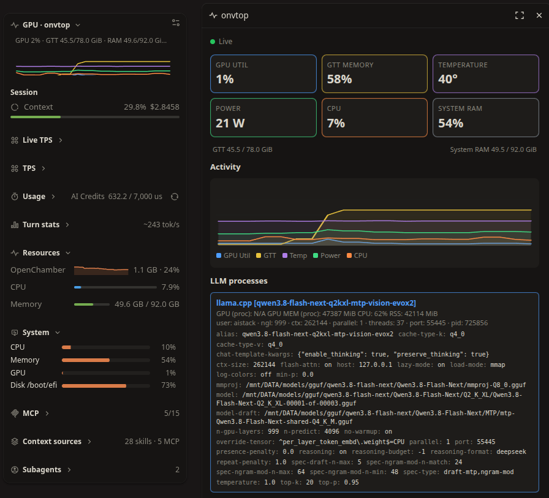

# onvtop

For those using local LLM, the [original nvtop CLI](https://github.com/syllo/nvtop) is the best insight into what your GPU is doing. I've taken that work and ported it to three other platforms:

* [OpenChamber Extension](https://github.com/DAE51D/openchamber-onvtop) (what you're looking at now)
* Kubuntu /[ KDE widget](https://github.com/DAE51D/knvtop)
* [Vobot Minidock LCD app](https://github.com/DAE51D/vobot-apps/tree/main/nvtop)

GPU-focused OpenChamber rail panel and compact Work Status graph, powered by the standalone [nvstats-service](https://github.com/DAE51D/nvstats-service) daemon.

The panel now includes read-only per-model cards for detected local inference processes, with process CPU/GPU/memory metrics and parsed launch flags where available. It does not expose process kill or restart controls.

The panel shows GPU utilization, shared GTT memory, temperature, power, CPU and system RAM. Its graph plots GPU utilization, GTT, temperature, power and CPU; system RAM is shown separately and is never presented as GPU RAM. Click a graph-backed card or legend label to toggle its line. Visibility preferences are saved and shared with the Work Status graph.

**onvtop also accurately shows the GPU RAM in the new shared CPU/GPU systems. Unlike many of the other system resource extensions out there, that would show only 2 GB for VRAM, this will correctly show 78 GB (for example).**



## Requirements

- Linux host with `nvstats-service` installed and running for the same user as the OpenChamber host service.
- `busctl` available on `PATH` (provided by systemd on typical Linux distributions).

> You do **not** need to install the [knvtop Plasma widget](https://store.kde.org/p/2370069/). Install the shared daemon once; both [knvtop](https://github.com/DAE51D/knvtop) and onvtop can use it.

> A web/server OpenChamber instance running under a different account cannot read another user's D-Bus session, so install the daemon for the account that runs that OpenChamber server.

onvtop reads the latest `com.daevid.nvstats.Sample.Get()` sample from the daemon user's D-Bus session. It does not poll GPU tools or duplicate the daemon's sampling.

Model cards are currently built from lightweight Linux process-argument detection for llama.cpp, Ollama, vLLM, SGLang, and Hugging Face TGI. Desktop clients are not listed as model processes. Per-model CPU/GPU counters are shown only when the runtime exposes them; Ollama model cards use Ollama's loaded-model API data.

## Install the shared daemon

For an AI-assisted installation, point your coding agent at the [onvtop install skill](SKILL.md). It covers the shared daemon and extension setup without assuming a particular Linux username.

```sh
git clone https://github.com/DAE51D/nvstats-service.git
cd nvstats-service
./install.sh
```

The installer checks for Python D-Bus/GLib bindings, installs the user service, and starts it. See the [nvstats-service README](https://github.com/DAE51D/nvstats-service#install) for distro dependencies and optional cross-user GPU process statistics.

`nvstats-service` reports GTT in MiB and system RAM in bytes; onvtop converts both to GiB for display.

## Install from GitHub

In OpenChamber, open **Settings → Extensions**, paste the repository URL, and choose **Add**:

```text
https://github.com/DAE51D/openchamber-onvtop
```

Approve the **Run a local service** permission, which allows the extension to run `busctl` and read the shared daemon's D-Bus sample. The panel appears on the rail; the compact graph is available in **Work Status** (enable **GPU · onvtop** in its section chooser if hidden). If the daemon is not running, onvtop reports that clearly rather than showing zeroes as live data.

## Install a local development folder

Use the absolute path to your clone in **Settings → Extensions → Add**. Folder installs run directly from that folder, so rebuilds can be tested without pushing. Do not edit OpenChamber's `extensions.json` by hand.

## Build and verify

Requires [Bun](https://bun.sh/):

```sh
bun install
bun run check
```

To smoke-test against a live `nvstats-service` daemon on the current session bus:

```sh
bun run smoke
```

The extension service reads and caches the latest D-Bus sample once per second, then serves it to the sandboxed panel and Work Status frame through OpenChamber's local service bridge.
